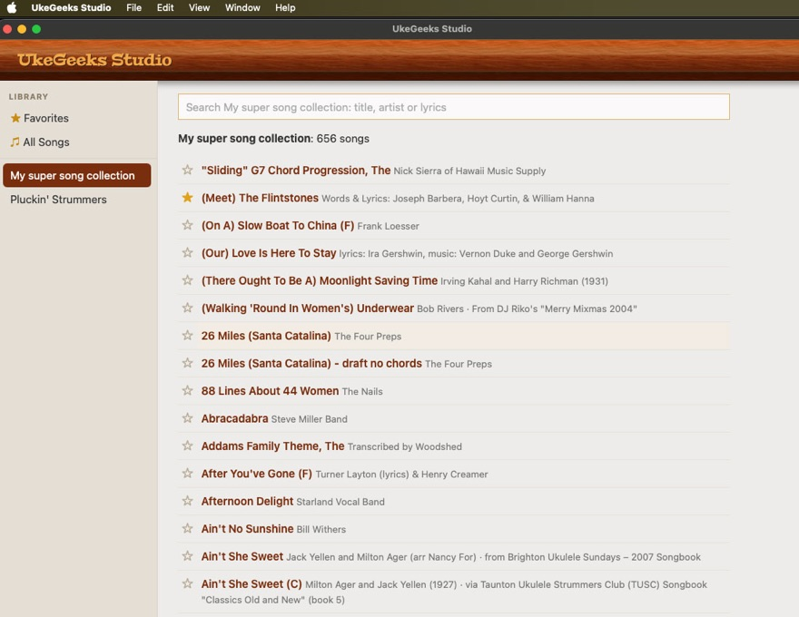
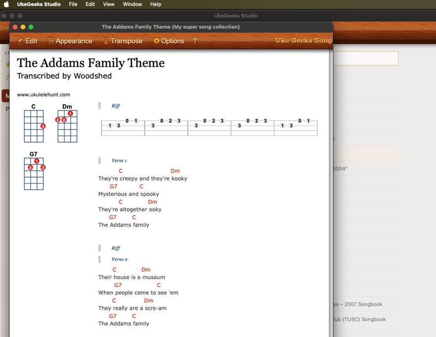
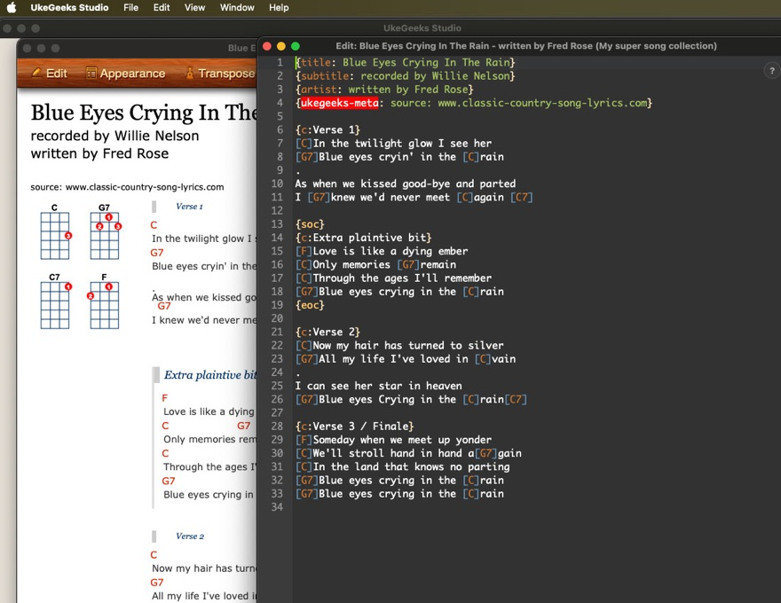

<p align="center">
  
</p>

<h1 align="center">UkeGeeks Studio</h1>

<p align="center">
  Your ukulele songs in tidy songbooks, on your Mac or Windows PC.
</p>

<p align="center">
  <a href="https://github.com/buzcarter/ukegeeks-studio/releases"></a>
  &nbsp;
  <a href="https://github.com/buzcarter/ukegeeks-studio/releases"></a>
  <br>
  <sub>Free beta · macOS 11 or later (Apple Silicon or Intel) · Windows 10 or 11, 64-bit</sub>
</p>

<p align="center">
  
</p>

Collect your songs, tidy them up in the Song-a-Matic editor, and see each one as a songsheet with ukulele chord diagrams. Made for anyone running a ukulele club or jam: you have songsheets from paper, PDFs and websites, and want **one tidy songbook** your members can print or read on a tablet. Most song editors are made for guitar and are too complicated; UkeGeeks Studio is simple and uke-first.

## Download

**[Get the latest beta from the Releases page.](https://github.com/buzcarter/ukegeeks-studio/releases)** It's free.

- **Mac** (macOS 11 or later, Apple Silicon or Intel): download the `.dmg`, open it and drag **UkeGeeks Studio** to Applications. It's signed and checked by Apple, so it opens with no warning.
- **Windows** (64-bit): download the `-setup.exe` and run it. It isn't signed yet, so Windows says "Windows protected your PC": click **More info**, then **Run anyway**.

It's a beta: keep a copy of any songs you care about, and [tell us what you find](https://github.com/buzcarter/ukegeeks-studio/issues).

## What it does

- **Songbooks are folders** of songs. Each song is a plain-text [ChordPro](https://www.chordpro.org/) file (`.cpm`), so nothing is locked in: the same files work in the [UkeGeeks Songbook](https://github.com/buzcarter/UkeGeeks) and other ChordPro apps. There's no account and no server; your songs stay on your computer.
- **Every song is a songsheet,** with chord diagrams, transpose, GCEA/DGBE/ADF#B tunings, color themes, tablature and a Chord Builder for your own chord shapes.
- **Edit a song beside its songsheet,** which follows as you type, with ChordPro colors, snippets and chord completion.
- **Favorites, All Songs and search** across every songbook, by title, artist or lyrics.
- **Print** any song. Coming next: a whole songbook as one PDF.

<table>
  <tr>
    <td width="50%"></td>
    <td width="50%"></td>
  </tr>
  <tr>
    <td align="center">A song</td>
    <td align="center">Editing it</td>
  </tr>
</table>

## Getting started

1. **Add a songbook:** click the **+** at the top of the window, then **Add Songbook…**, pick a folder of `.cpm` songs and give it a name. It joins the **Library** in the sidebar. (Songs saved as `.txt`? Turn those on in Settings: UkeGeeks Studio > Settings… on a Mac, File > Settings… on Windows.)
2. **Open a song:** click it in the list, or double-click a `.cpm` file in Finder or Explorer. Each song opens in its own window.
3. **Edit it:** Edit > Edit Song. The songsheet follows as you type; **Save** writes the file. The **?** in the Edit window's corner lists the shortcuts and ChordPro snippets.
4. **Make a new song** with **+** > **New Song…**.

More to find:

- **Search** (Cmd+F) looks through what's selected in the sidebar, by title, artist or lyrics: one songbook, Favorites, or **All Songs**.
- **Favorites:** click the ☆ beside a song to star it; **Favorites**, at the top of the sidebar, lists the starred songs of every songbook.
- **Right-click a songbook** to rename it, show its folder, point it at another folder, or take it out of the Library (the folder and its songs stay on disk). A red **!** means its folder can't be found, for example on an unplugged drive.
- **File > Open Recent** lists the last 10 songs.

### Keyboard shortcuts

| Shortcut | Menu item | What it does |
|---|---|---|
| Cmd+N | File > New Song… | Asks for a title and artist, then creates "Title - Artist.cpm" in the selected songbook (never overwriting) and opens it in a new window. With no songbook selected, adds one to the Library first. |
| Cmd+O | File > Open… | Opens one song file on its own (any ChordPro type, from anywhere, not just the Library) in a new window, without access to its folder. |
| Shift+Cmd+O | File > Add Songbook to Library… | Picks a folder and adds it to the Library sidebar. |
| Cmd+S | File > Save | Saves the song (the editor's Save button). |
| Shift+Cmd+S | File > Save As… | Saves under a new name, and the editor switches to the new file: in the songbook folder as one of its songs, anywhere else as a song on its own. |
| Cmd+, | UkeGeeks Studio > Settings… | Which song file types the list shows (`.cpm`, `.txt`, other ChordPro extensions), how song files are named (and renamed when a song's title or artist changes), and whether to reopen the last songbook. Kept in `settings.json`. |
| Cmd+L | View > Show Song List | Goes back to the song list, asking about unsaved changes first. |
| Cmd+P | File > Print… | Prints the open song as shown, with the editor's print styles (the system Print dialog picks the paper). |
| Cmd+W | File > Close Window | Closes the window, asking about unsaved changes first. |
| Cmd+Q | UkeGeeks Studio > Quit | Quits, asking about unsaved changes first (so does Quit in the Dock). |
| Cmd+Z, Shift+Cmd+Z, Cmd+X, Cmd+C, Cmd+V, Cmd+A | Edit | Undo, Redo, Cut, Copy, Paste, Select All in the text boxes. |

View > Enter Full Screen and Help (UkeGeeks Studio Help, ChordPro Reference) have no shortcuts. On Windows the shortcuts use Ctrl instead of Cmd, Quit is File > Exit, Settings… is in File, and About is in Help. The editor's own controls (themes, transpose, the Chord Builder) stay in the editor.

## For developers

UkeGeeks Studio is built with [Tauri 2](https://tauri.app/): the pages are plain HTML, CSS and JavaScript, the app around them is Rust. The plan is in [docs/ROADMAP.md](docs/ROADMAP.md), what changed in [CHANGELOG.md](CHANGELOG.md), and how releases are built and signed in [docs/RELEASING.md](docs/RELEASING.md).

### Run it from source

You need [Node.js](https://nodejs.org/) 24 or later and [Rust](https://www.rust-lang.org/tools/install). On a Mac, the Xcode Command Line Tools are enough (`xcode-select --install`).

```
npm install
npm run dev
```

The first `npm run dev` downloads and compiles Tauri, which takes a few minutes and about 1.5 GB of disk in `src-tauri/target/`. Later runs start in seconds. `cargo clean` in `src-tauri/` gives the space back.

Editing files under `web/` reloads the window. `npm test` runs the tests for the song list code and `npm run lint` checks the JavaScript; in `src-tauri/`, `cargo test` runs the Rust tests. `npm run preview` serves the pages to a browser on http://localhost:8765 with a fake Tauri (no real files), for trying the pages without the app; see `scripts/preview/fake-tauri.js`.

### How the project is laid out

| Folder | What's in it |
|---|---|
| `web/` | The app's pages: plain HTML, CSS and JavaScript, no bundler. `index.html` is the song list, `editor.html` the editor. |
| `web/js/` | One script per page (`list.js`, `editor.js`, `settings.js`); what they share is in `lib/`, the pages' dialogs in `dialogs/`, pieces of the song list in `ui/`. |
| `web/js/lib/songs.js` | Reads song titles and artists, sorts the list, saves songs. From the Songbook's `server/lib/songs.js`, changed to use Tauri's file access. |
| `web/vendor/` | The editor, Song Formatter and Ace, copied from `node_modules/` by `scripts/vendor.js` each time the app starts. Not committed. |
| `web/fonts/` | The fonts the editor's color themes use, so the app works offline. |
| `src-tauri/` | The Tauri app. `capabilities/default.json` lists what the pages may do: pick a folder, then read and write the files directly in it. `src/lib.rs` starts the app; `src/menu.rs` builds the menu; `src/windows.rs` the song windows; `src/library.rs` keeps the Library in `library.json`, `src/favorites.rs` the Favorites in `favorites.json`, `src/recent.rs` File > Open Recent in `recent.json` and `src/settings.rs` the settings in `settings.json` (all in `~/Library/Application Support/org.ukegeeks.studio/`, written by `src/store.rs`). The full map is in [docs/HANDOFF.md](docs/HANDOFF.md). |

## Part of the UkeGeeks family


| Module                                                                        | Package                                                                                                    | What it does                                                                                                                 |
|-------------------------------------------------------------------------------|------------------------------------------------------------------------------------------------------------|------------------------------------------------------------------------------------------------------------------------------|
| **UkeGeeks Studio**                                                           | [this repo](https://github.com/buzcarter/ukegeeks-studio)                                                  | The desktop app                                                                                                              |
| [Song Editor](https://github.com/buzcarter/song-editor)                       | [npmjs `@ukegeeks/song-editor`](https://www.npmjs.com/package/@ukegeeks/song-editor)                       | The Song-a-Matic editor: menus, dialogs, Chord Builder, fullscreen editing. [Demo](https://buzcarter.github.io/song-editor/) |
| [Song Formatter](https://github.com/buzcarter/song-formatter)                 | [npmjs `@ukegeeks/song-formatter`](https://www.npmjs.com/package/@ukegeeks/song-formatter)                 | Reads ChordPro, draws the songsheet and SVG chord diagrams [Demo](https://buzcarter.github.io/song-formatter/)               |
| [ACE ChordPro Extension](https://github.com/buzcarter/ace-chordpro-extension) | [npmjs `@ukegeeks/ace-chordpro-extension`](https://www.npmjs.com/package/@ukegeeks/ace-chordpro-extension) | Highlighting and autocomplete for the fullscreen editor[Demo](https://buzcarter.github.io/ace-chordpro-extension/)           |
| [UkeGeeks Songbook](https://github.com/buzcarter/UkeGeeks)                    | [GitHub](https://github.com/buzcarter/ukegeeks)                                                            | The self-hosted web songbook[Demo](https://buzcarter.github.io/UkeGeeks/)                                                    |
| [ukegeeks.org](https://ukegeeks.org)                                          |                                                                                                            | The home site with tutorials, examples, & videos                                                                             |

## License

GPL-3.0. Copyright 2026 Buz Carter.
